# LobbyCast

**Digital signage platform for lobby TVs: slides, synchronized teaching schedules and live control of every screen from one dashboard.**

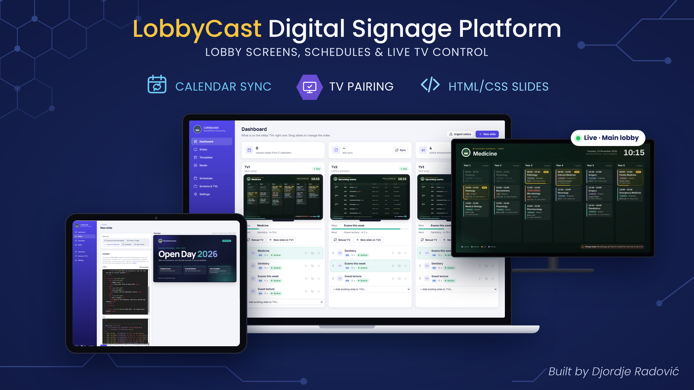

> **Public Showcase / Curated Subset**  
> This repository is a curated public showcase of a private production system. It contains documentation, anonymized screenshots, architecture diagrams and example slides. All screenshots come from a separate demo instance with a fictional organisation ("Northfield University") and fictional data. The production source code, credentials, infrastructure configuration and institutional data remain private.

---

## Project at a Glance

| | |
|---|---|
| **Status** | Production system running the lobby TVs of a higher-education institution every day |
| **My role** | Sole developer: concept, backend, admin interface, TV player, deployment and maintenance |
| **Scale** | 3 paired lobby TVs, 40 synchronized calendars, bilingual content (Serbian / English) |
| **Production stack** | ASP.NET Core MVC (Razor) on .NET 10, Entity Framework Core, SQL Server, SignalR, ICS / Google Calendar sync, Nginx, Chromium kiosk player |
| **Key challenges** | Unattended 24/7 playback, instant remote control, readable on-screen schedules from raw calendar data, white-label branding |
| **Source availability** | Production source is private; this repository contains documentation, screenshots and example slides |

### My Responsibilities

- designed the product: screens, playlists, slide types and the TV pairing flow
- developed the admin dashboard and slide editor with ASP.NET Core MVC and Razor views
- implemented real-time control of the TVs with SignalR
- built the calendar synchronization and the parsing of event titles into subject, type and group
- designed the custom HTML/CSS slide format with branding placeholders and entrance animations
- implemented code-based device pairing, device status and per-device licensing
- prepared the kiosk setup for unattended mini PCs behind the TVs
- deployed and maintain the system in production

---

## Table of Contents

- [Project at a Glance](#project-at-a-glance)
- [Overview](#1-overview)
- [Key Features](#2-key-features)
- [System Architecture](#3-system-architecture)
- [Engineering Highlights](#4-engineering-highlights)
- [Security and Reliability](#5-security-and-reliability)
- [Production Impact](#6-production-impact)
- [Design Decisions](#7-design-decisions)
- [Screenshots](#8-screenshots)
- [Documentation and Examples](#9-documentation-and-examples)
- [Tech Stack](#10-tech-stack)
- [Contact](#11-contact)
- [License](#license)

---

## 1. Overview

LobbyCast is a digital signage platform for institutions that want to show schedules, announcements and events on TVs in their lobbies and hallways.

Schedules usually already exist in calendars, but without a dedicated system it is hard to show them on lobby TVs in a readable form, keep them up to date automatically and control several screens from one place.

LobbyCast solves this with three parts:

- an **admin dashboard** where staff manage slides, playlists, schedules and devices
- a **TV player** that runs in a browser on each TV and shows its playlist
- a **real-time connection** between them, so every change appears on the screens immediately

The system runs in production on three lobby TVs of a higher-education institution and shows teaching schedules for study programmes taught in Serbian and English.

---

## 2. Key Features

- live preview of every TV in the dashboard, with the current and next slide and a countdown
- drag-and-drop playlists per screen; slides can be reordered, hidden or removed
- five slide types: announcements (template), posters / images, custom HTML/CSS, schedules and "now & next"
- custom HTML/CSS slide editor with a pixel-exact 1920×1080 live preview
- teaching schedules synchronized from ICS / public Google Calendar links, per study programme and year
- parsing of structured event titles, so parallel groups of the same class are merged on screen
- urgent notices pushed to the screens in seconds
- remote "Reload TV" without going to the device
- code-based TV pairing; several TVs can share one screen (playlist)
- online status and last-seen time for every device, with one-click revoke
- per-device licensing
- white-label branding: organisation name, logo and colours sent to every TV instantly
- night mode that turns the screens black overnight
- bilingual admin interface (English / Serbian)

---

## 3. System Architecture

LobbyCast is an **ASP.NET Core MVC** application on .NET 10 with **SQL Server** and **Entity Framework Core**. The admin interface is built with **Razor views**, and the TVs are kept in sync through a **SignalR** hub. The application runs behind an **Nginx** reverse proxy with HTTPS.

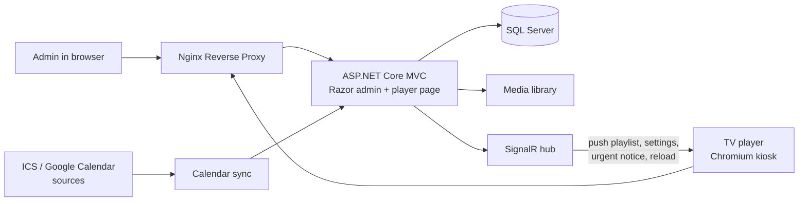

The admin saves a change, the application stores it and pushes it to the connected TVs through SignalR. The TVs do not need to be refreshed or touched.

For the components, data flow and the pairing sequence, see **[architecture.md](docs/architecture.md)**.

---

## 4. Engineering Highlights

### Live Control of Every Screen

The dashboard shows a live preview of each TV, the slide that is on screen now, the next slide and a countdown. Playlists are edited with drag and drop, and changes are pushed to the TVs through SignalR the moment they are saved.

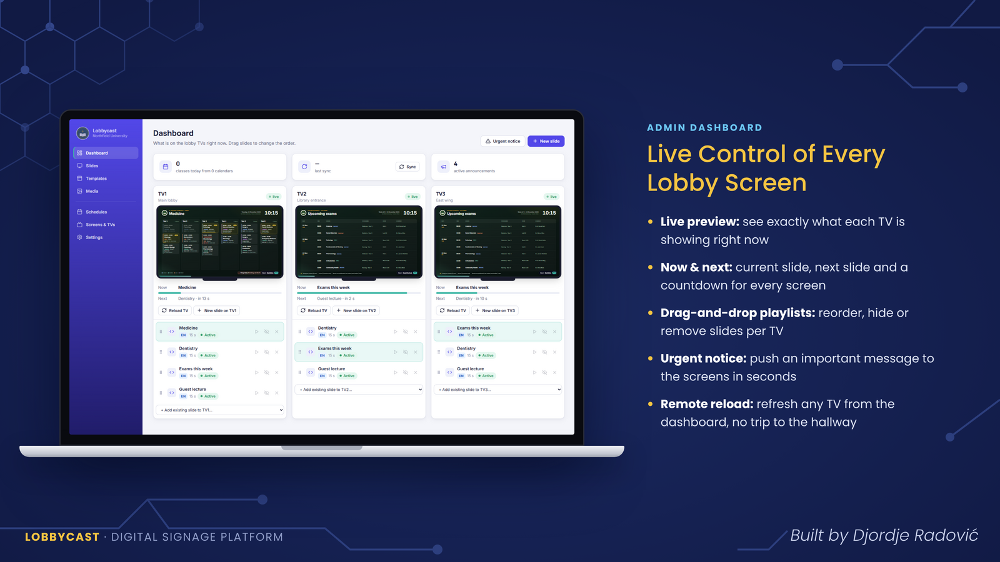

*Each column is one TV: live preview, now & next, playlist and remote actions.*

---

### Code-Based TV Pairing

A TV is paired without typing passwords on a remote control:

1. the mini PC behind the TV opens the player page
2. the player shows a 6-character code
3. the admin enters the code in the dashboard and chooses which screen (playlist) the TV shows

The system separates a **screen** (what is shown) from a **TV** (the physical device). Several TVs can show the same screen, every device reports its online status and last-seen time, and a device can be revoked with one click. The number of paired TVs is limited by the licence.

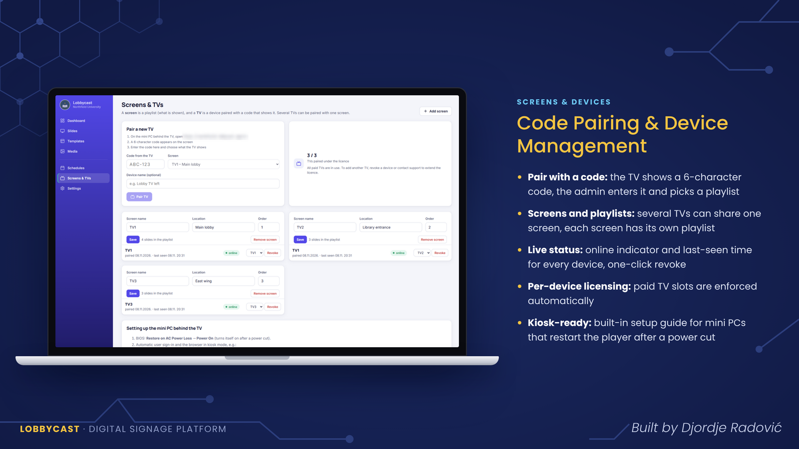

For the full flow and the kiosk setup, see **[tv-pairing-and-player.md](docs/tv-pairing-and-player.md)**.

---

### Schedules from Calendar Data

Each study programme has its own set of calendars, one per year or track, added as ICS links or embed links of public calendars. The programme also defines its teaching language, so English-taught programmes get English schedule slides.

Raw calendar titles are often written in a compact form such as `Subject – type gr.2`. In structured mode, LobbyCast splits the title into **subject**, **type** and **group**, so parallel groups of the same class are shown as one entry instead of several near-identical cards.

For the details, see **[schedule-sync.md](docs/schedule-sync.md)**.

---

### Custom HTML/CSS Slides

For content that templates cannot cover, the editor accepts custom HTML and CSS on a fixed 1920×1080 canvas, with a live preview that looks exactly like the TV.

Slides can use:

- the `var(--brand)` and `var(--accent)` CSS variables, which follow the colours from Settings
- the `{{logo}}` and `{{ustanova}}` (organisation name) placeholders
- the Inter and Manrope fonts
- entrance animations under the `.show` class, which start when the slide appears on screen

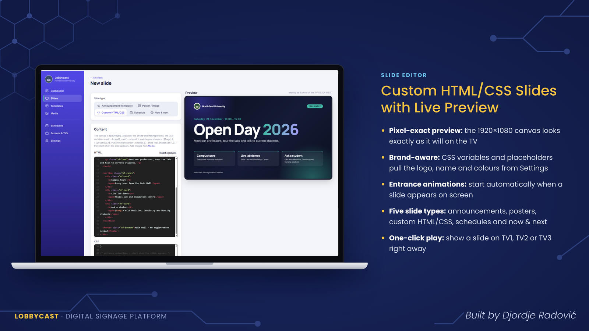

The authoring guide is in **[custom-slides.md](docs/custom-slides.md)**, and ready-made example slides are in **[examples/custom-slides](examples/custom-slides)**.

---

### White-Label Branding and Bilingual Content

The organisation name (with an optional English version), logo, main and accent colours and schedule titles are set in one place and sent to every TV immediately. The admin interface can be switched between English and Serbian.

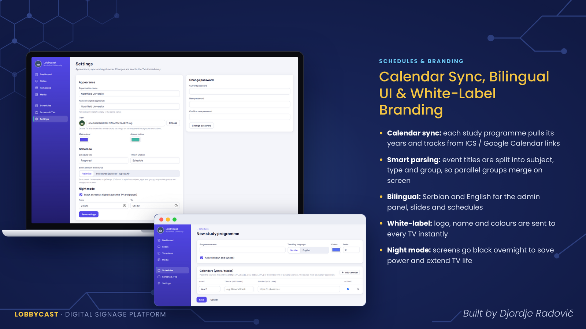

---

## 5. Security and Reliability

### Security

- the admin dashboard is protected by sign-in
- TVs are added only through a pairing code that an admin enters in the dashboard
- every paired device is visible with its status and can be revoked immediately
- paired devices are limited by the licence

### Reliability

LobbyCast runs unattended in hallways, so the player is designed to recover on its own:

- the mini PC is set to power on automatically after a power cut
- the player starts in Chromium kiosk mode at sign-in, without error dialogs or info bars
- sleep, screen saver and system notifications are turned off
- the TV's automatic power-off is disabled and HDMI-CEC is enabled
- the pairing is stored in the player's browser, so the TV reconnects after a restart
- night mode blanks the screens overnight to save power and extend TV life
- admins can reload any TV remotely from the dashboard

---

## 6. Production Impact

- runs the lobby TVs of a higher-education institution every day
- shows teaching schedules from 40 synchronized calendars without manual re-entry
- serves both Serbian- and English-taught study programmes
- lets staff change what is on every screen from one dashboard, in real time
- removes the need to physically visit a TV to update or restart it

---

## 7. Design Decisions

- **Screens and TVs are separate concepts.** A playlist is defined once and can be shown on any number of devices, so adding a TV does not mean duplicating content.
- **Push instead of refresh.** SignalR pushes changes to the TVs, so updates and urgent notices appear immediately instead of on the next page reload.
- **Pairing codes instead of credentials on the TV.** Nobody has to type a password with a remote control, and access can be revoked from the dashboard.
- **Calendars stay the source of the schedule.** LobbyCast reads existing calendars instead of asking staff to enter the schedule a second time.
- **Custom slides stay inside a fixed contract.** A fixed canvas, brand variables and placeholders let custom slides follow the organisation's branding without editing every slide.
- **A demo instance for presentations.** Public screenshots come from a separate instance with fictional data, so no institutional data is ever shown.

---

## 8. Screenshots

All screenshots are from the demo instance with fictional data.

### Dashboard

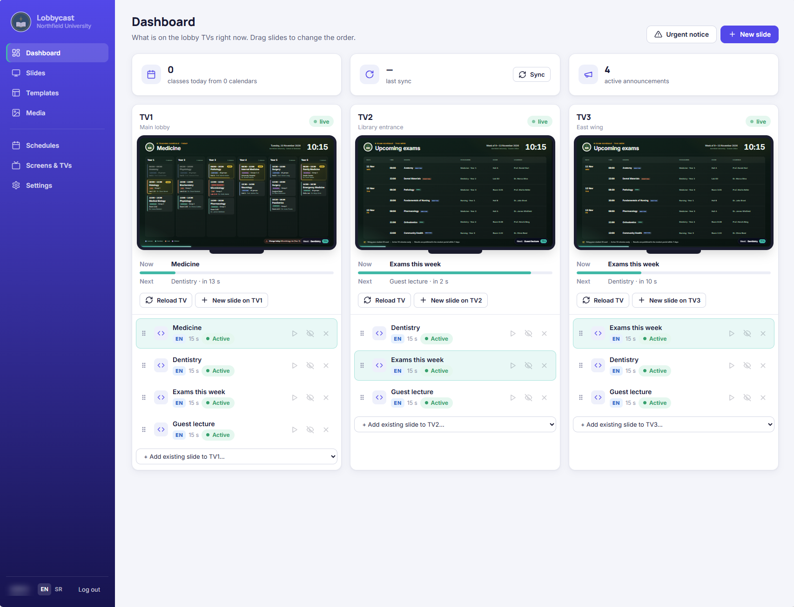

### Slide Editor – Custom HTML/CSS

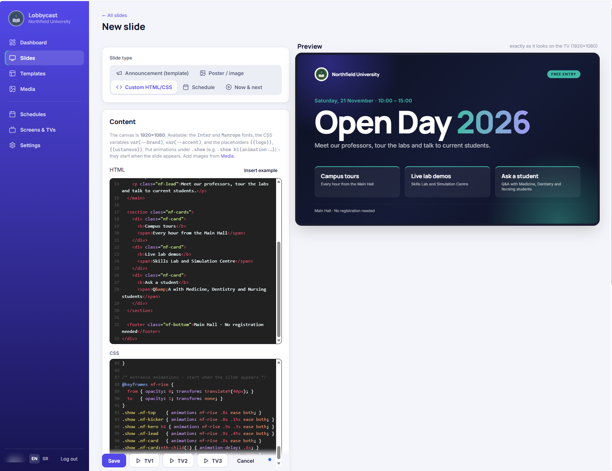

### Screens and TVs

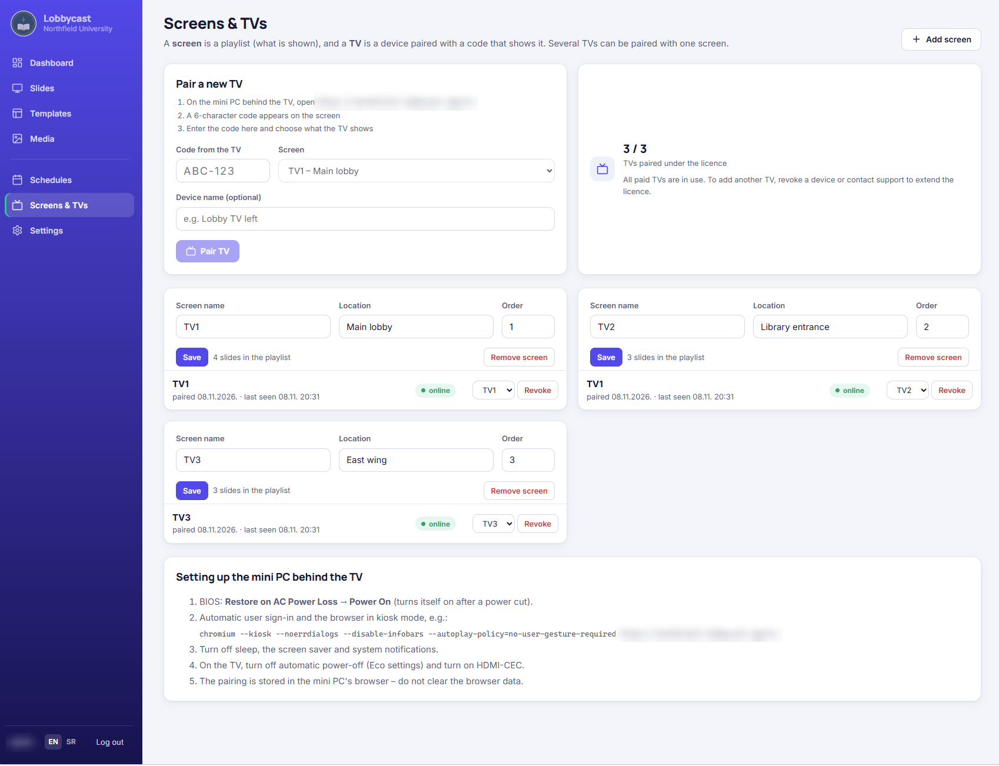

### Settings

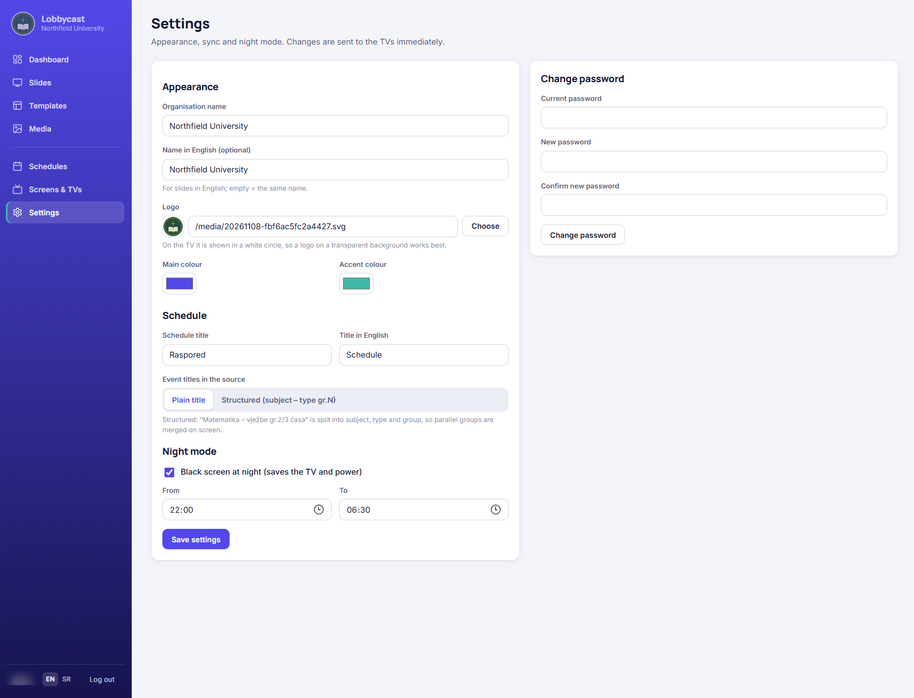

### New Study Programme

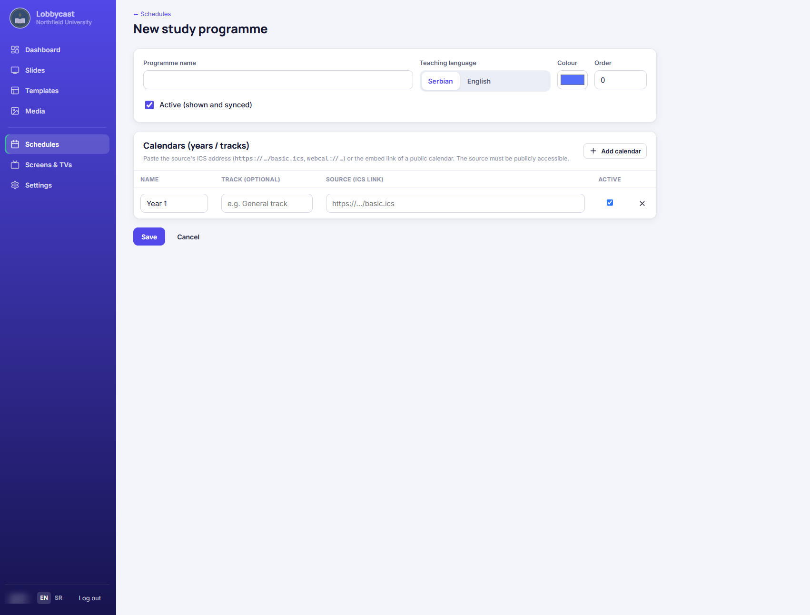

### Example Slides on the TV

| | |
|---|---|
| 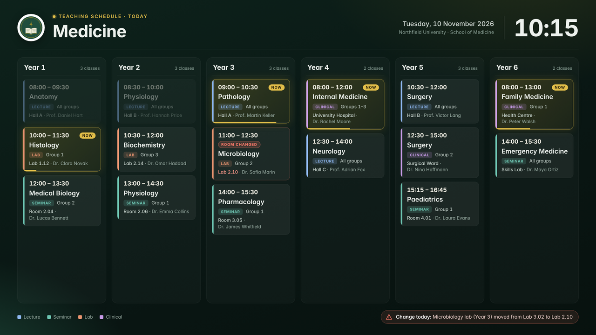 | 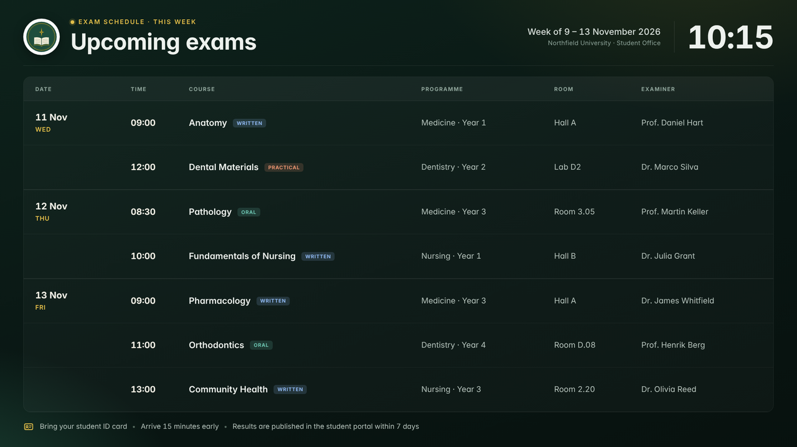 |
| 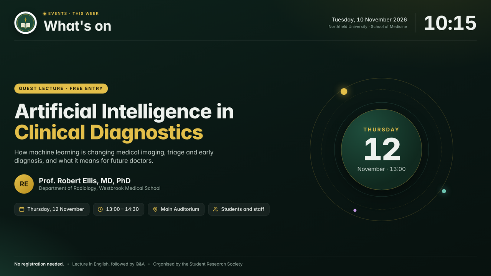 | 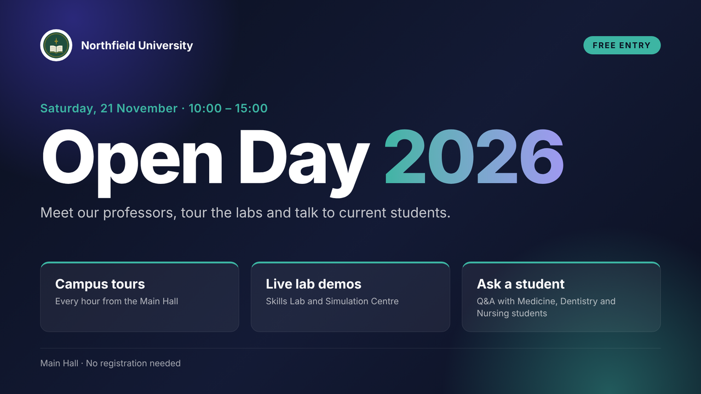 |

---

## 9. Documentation and Examples

### Documentation

- **[architecture.md](docs/architecture.md)** - components, data flow and real-time updates
- **[tv-pairing-and-player.md](docs/tv-pairing-and-player.md)** - pairing flow, device management and kiosk setup
- **[schedule-sync.md](docs/schedule-sync.md)** - study programmes, calendar sources and title parsing
- **[custom-slides.md](docs/custom-slides.md)** - how to write custom HTML/CSS slides
- **[demo-instance.md](docs/demo-instance.md)** - how the anonymized demo instance is set up

### Example Slides

- **[open-day](examples/custom-slides/open-day)** - announcement slide using brand variables, placeholders and entrance animations
- **[demo-kit](examples/custom-slides/demo-kit)** - six demo slides: three teaching schedules, exams, a guest lecture and a Serbian schedule

---

## 10. Tech Stack

### Backend

- ASP.NET Core MVC (.NET 10)
- C#
- Entity Framework Core
- SQL Server
- SignalR for real-time communication with the TVs
- calendar synchronization from ICS / Google Calendar sources

### Admin Interface

- Razor views
- custom CSS with theme colours from Settings
- bilingual interface (English / Serbian)

### TV Player

- browser-based player page
- Chromium in kiosk mode on a mini PC behind each TV
- custom HTML/CSS slides on a 1920×1080 canvas

### Infrastructure

- Nginx reverse proxy
- HTTPS

---

## 11. Contact

**Đorđe Radović**

Email: djordjeradovic94@gmail.com

Demo available upon request.

---

## License

© Đorđe Radović. All rights reserved.

This repository is provided for portfolio and presentation purposes only. Unauthorized use, reproduction or distribution is prohibited.
