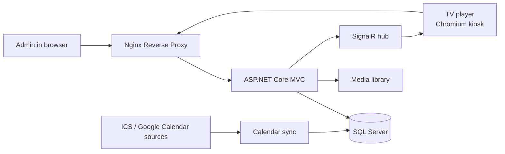
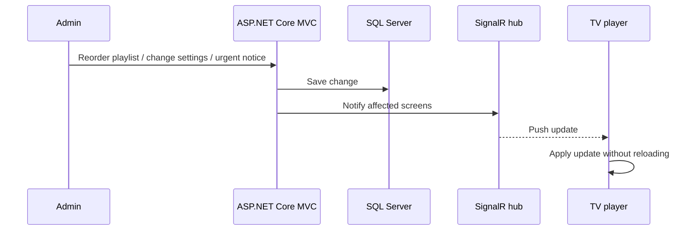
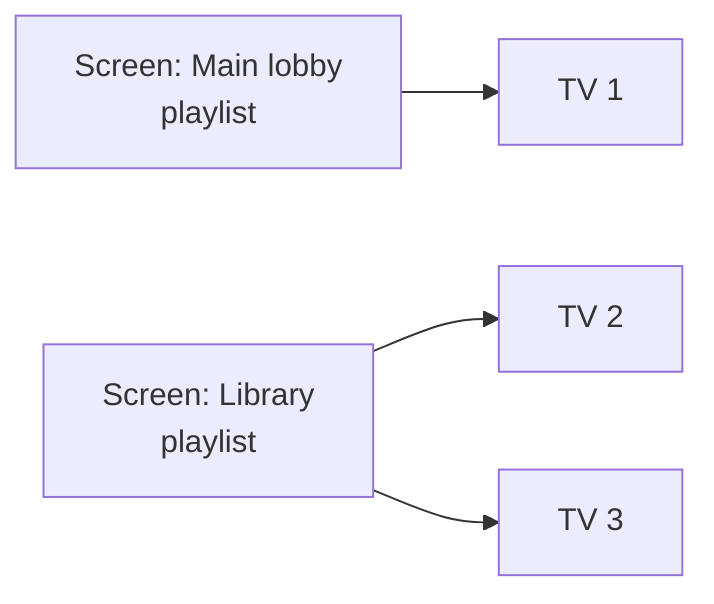

# System Architecture

This document explains the high-level architecture of **LobbyCast**, its main components and how changes travel from the admin dashboard to the TVs.

---

## 1. Architecture Overview

LobbyCast is an **ASP.NET Core MVC** application on .NET 10, with **SQL Server** as the database, accessed through **Entity Framework Core**. The same application serves:

- the **admin dashboard**, built with Razor views
- the **TV player page**, opened in a browser on the device behind each TV
- a **SignalR hub**, which keeps every connected TV in sync

The application runs behind an **Nginx** reverse proxy with HTTPS.

---

## 2. Main Components

### Admin Dashboard

The dashboard is the single place where staff control the screens:

- **Dashboard** - live preview of every TV, now & next, playlists, urgent notice, remote reload
- **Slides** - creating and editing slides of all five types
- **Templates** - reusable announcement templates
- **Media** - images used in slides
- **Schedules** - study programmes and their calendar sources
- **Screens & TVs** - screens (playlists), device pairing, status and licence
- **Settings** - organisation branding, schedule titles, title parsing and night mode

### TV Player

The player is a web page opened in Chromium kiosk mode on a mini PC behind each TV. After pairing, it receives its playlist and settings, plays the slides in order and listens for real-time commands.

### SignalR Hub

The hub keeps an open connection with every paired TV. When an admin changes something, the server pushes the change to the affected TVs instead of waiting for them to reload.

### Calendar Sync

Each study programme has a list of calendar sources (one per year or track). The sync reads these sources, normalizes the events and prepares them for schedule slides. The dashboard shows the time of the last sync and allows a manual sync at any moment.

---

## 3. Data Flow: From Dashboard to TV

The same channel is used for remote actions:

- **Reload TV** - the player reloads itself
- **Urgent notice** - an important message is shown on the screens
- **Settings** - new branding or night mode settings are applied immediately

---

## 4. Screens and TVs

LobbyCast separates two concepts:

- a **screen** is a playlist: what is shown, in which order and for how long
- a **TV** is a physical device paired with a code that shows one screen

This means that content is defined once and can be shown on several devices, and a broken TV can be replaced by pairing a new one with the same screen.

For the pairing flow, see **[tv-pairing-and-player.md](tv-pairing-and-player.md)**.

---

## 5. Slide Types

| Type | Purpose |
|---|---|
| Announcement (template) | Text announcements based on reusable templates |
| Poster / image | Full-screen images from the media library |
| Custom HTML/CSS | Free-form slides on a 1920×1080 canvas, see **[custom-slides.md](custom-slides.md)** |
| Schedule | Teaching schedule generated from calendar sources, see **[schedule-sync.md](schedule-sync.md)** |
| Now & next | What is happening now and what comes next |

---

## 6. Branding

Settings hold the organisation name (with an optional English version), the logo, the main and accent colours and the schedule titles in both languages. These values are:

- used by the built-in slide types
- available to custom slides through CSS variables and placeholders
- pushed to the TVs immediately after saving

---

## 7. Summary

The architecture focuses on:

- one place to control every screen
- immediate updates through a persistent real-time connection
- unattended, self-recovering playback on the TVs
- schedules that come from existing calendars instead of manual entry
- branding that is defined once and applied everywhere
