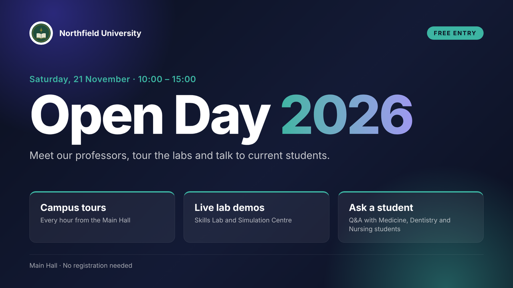

# Custom HTML/CSS Slides

This guide explains how to write custom slides for LobbyCast. Custom slides are used when the built-in slide types are not enough: event posters, special announcements, campaign screens or custom schedule layouts.

---

## 1. The Canvas

- The canvas is **1920×1080** pixels. The slide is scaled to the TV, so always design for this size.
- The editor shows a live preview that looks exactly like the TV.
- The editor has two fields: **HTML** and **CSS**.

---

## 2. What a Slide Can Use

### Fonts

The **Inter** and **Manrope** fonts are available without importing anything.

### Brand colours

| Variable | Value |
|---|---|
| `var(--brand)` | Main colour from Settings |
| `var(--accent)` | Accent colour from Settings |

When the organisation changes its colours in Settings, every slide that uses these variables changes with them.

### Placeholders

| Placeholder | Replaced with |
|---|---|
| `{{logo}}` | Address of the organisation logo, for example `` |
| `{{ustanova}}` | Organisation name |

### Entrance animations

When a slide appears on the screen, it receives the `.show` class. Put animations under `.show`, and they will start every time the slide is shown:

```css
@keyframes nf-rise {
  from { opacity: 0; transform: translateY(40px); }
  to   { opacity: 1; transform: none; }
}
.show .nf-title { animation: nf-rise .8s ease both; }
.show .nf-lead  { animation: nf-rise .8s .2s ease both; }
```

---

## 3. Minimal Example

**HTML**

```html
<div class="nf-slide">
  
  <h1 class="nf-title">Welcome to {{ustanova}}</h1>
  <p class="nf-lead">Library open until 22:00 during the exam period.</p>
</div>
```

**CSS**

```css
.nf-slide {
  width: 1920px;
  height: 1080px;
  padding: 120px;
  box-sizing: border-box;
  font-family: Manrope, Inter, sans-serif;
  color: #fff;
  background: linear-gradient(135deg, #0B1020, var(--brand));
}
.nf-logo  { width: 110px; height: 110px; padding: 8px; border-radius: 50%; background: #fff; }
.nf-title { margin: 60px 0 0; font-size: 120px; line-height: 1; }
.nf-lead  { margin-top: 40px; font-size: 44px; color: var(--accent); }
```

---

## 4. Best Practices

- **Prefix every class** (for example `nf-`). Generic names like `.slide` or `.card` can collide with the player's own styles.
- **Write for distance.** Text on a lobby TV is read from several metres away: keep body text at 24 px or more and titles much larger.
- **Use the brand variables** instead of fixed colours, so the slide follows Settings.
- **Keep the slide self-contained.** Use images from the Media library and avoid external scripts and fonts.
- **Use `animation-fill-mode: both`** (the `both` keyword) so elements do not flash before the animation starts.
- **Check the preview** before saving: what you see there is what the TV shows.

---

## 5. Examples

Ready-made slides are in **[examples/custom-slides](../examples/custom-slides)**:

| Example | Shows |
|---|---|
| [open-day](../examples/custom-slides/open-day) | brand variables, both placeholders and staggered entrance animations |
| [demo-kit](../examples/custom-slides/demo-kit) | teaching schedules with "now", past and changed states, an exam table, an event poster and a Serbian schedule |


