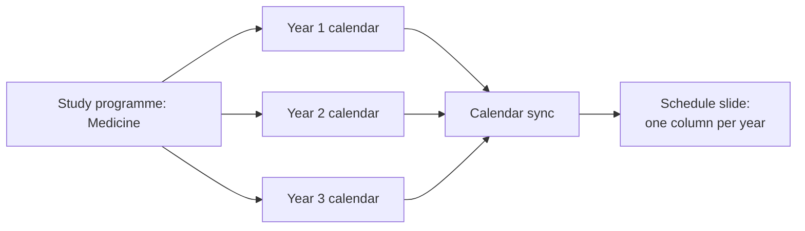

# Schedule Synchronization

This document describes how LobbyCast turns calendar data into readable teaching schedules on the TVs.

---

## 1. Study Programmes

Schedules are organised by **study programme**. Each programme has:

| Field | Purpose |
|---|---|
| Programme name | Shown as the title of the schedule slide |
| Teaching language | Serbian or English; English-taught programmes get English schedule slides |
| Colour | Used to tell programmes apart |
| Order | Position of the programme in lists |
| Active | Only active programmes are shown and synchronized |

---

## 2. Calendar Sources

Each programme has one calendar per **year** or **track**. A calendar is added as:

- an ICS address (`https://.../basic.ics` or `webcal://...`), or
- the embed link of a public calendar

The source must be publicly accessible. Each calendar can be switched on or off without deleting it.



The dashboard shows how many classes are scheduled today across all calendars and when the last sync ran. A manual **Sync** is available at any time.

---

## 3. Event Title Parsing

Calendars are often maintained by different people, and event titles carry more information than just the subject. LobbyCast supports two modes:

### Plain title

The event title is shown as it is.

### Structured title

The title follows the pattern `Subject – type gr.N`, for example:

```
Matematika – vježbe gr.2/3 časa
```

LobbyCast splits it into:

| Part | Value |
|---|---|
| Subject | Matematika |
| Type | vježbe (practical class) |
| Group | 2 |

When several groups have the same class at the same time, they are **merged into one entry** on screen instead of being shown as several near-identical cards. This keeps the schedule readable from a distance.

---

## 4. On the TV

Schedule slides show one column per year, with the time, subject, type, group, room and lecturer of each class. The schedule title is set in Settings in both languages (for example "Raspored" / "Schedule").

The custom demo slides in **[examples/custom-slides/demo-kit](../examples/custom-slides/demo-kit)** show the same idea with extra visual states: the class in progress is highlighted with a progress bar, finished classes are dimmed and room or time changes are flagged.

---

## 5. Summary

- calendars remain the single source of the schedule
- staff do not enter the schedule a second time
- structured titles become clean, merged entries on screen
- English-taught programmes get schedules in English
