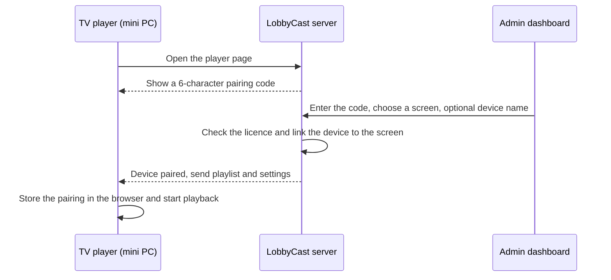

# TV Pairing and Player

This document describes how a TV is connected to LobbyCast, how devices are managed and how the player is set up to run unattended.

---

## 1. Pairing Flow

A TV is paired with a short code, so nobody has to type a username or password with a remote control.



Steps for the admin:

1. On the mini PC behind the TV, open the player page of your LobbyCast instance (`https://<your-instance>/tv`).
2. A 6-character code appears on the screen.
3. In **Screens & TVs**, enter the code, choose the screen the TV should show and optionally give the device a name (for example "Lobby TV left").

---

## 2. Device Management

For every paired device, the dashboard shows:

- the screen it belongs to
- when it was paired
- whether it is **online**, and when it was last seen
- a selector to move it to another screen
- a **Revoke** button that removes the device immediately

Several TVs can be paired with the same screen, so they always show the same playlist.

### Licensing

The number of paired TVs is limited by the licence. When all paid slots are used, a new TV can be added only after another device is revoked or the licence is extended.

---

## 3. Remote Control

From the dashboard, every TV can be controlled without going to the device:

| Action | Result on the TV |
|---|---|
| Reorder, hide or remove slides | The playlist changes immediately |
| New slide on TV | A new slide is added to that TV's playlist |
| Play | A selected slide is shown on the TV right away |
| Urgent notice | An important message is shown on the screens |
| Reload TV | The player reloads itself |

All actions are delivered through SignalR.

---

## 4. Kiosk Setup for the Mini PC

The TVs are in hallways and nobody is there to click anything, so the device behind each TV is set up to start and recover on its own.

1. **BIOS:** set *Restore on AC Power Loss* to *Power On*, so the PC turns itself on after a power cut.
2. **Automatic sign-in** and the browser in kiosk mode at startup, for example:

   ```
   chromium --kiosk --noerrdialogs --disable-infobars --autoplay-policy=no-user-gesture-required https://<your-instance>/tv
   ```

3. **Turn off** sleep, the screen saver and system notifications.
4. **On the TV:** turn off automatic power-off (Eco settings) and turn on HDMI-CEC.
5. **Keep the browser data.** The pairing is stored in the mini PC's browser, so clearing the browser data would unpair the TV.

---

## 5. Night Mode

Night mode turns the screens black during a configured period (for example 21:00 – 06:30). This saves power and extends the life of the TVs, while the player stays connected and resumes playback in the morning without any action.

---

## 6. Summary

The pairing and player design focuses on:

- adding a TV quickly, without credentials on the device
- full visibility and control of every device from the dashboard
- unattended operation that survives power cuts and restarts
