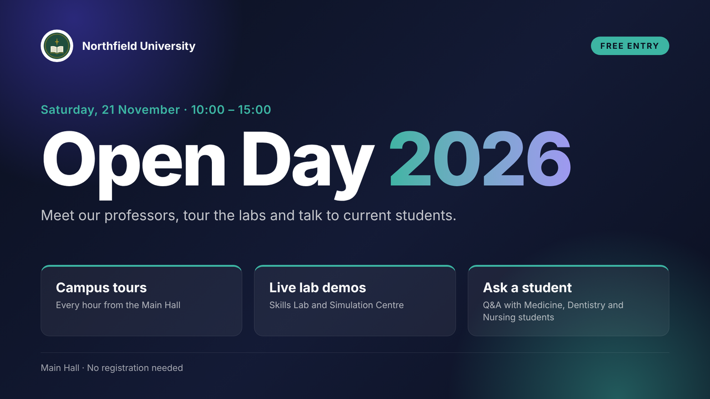
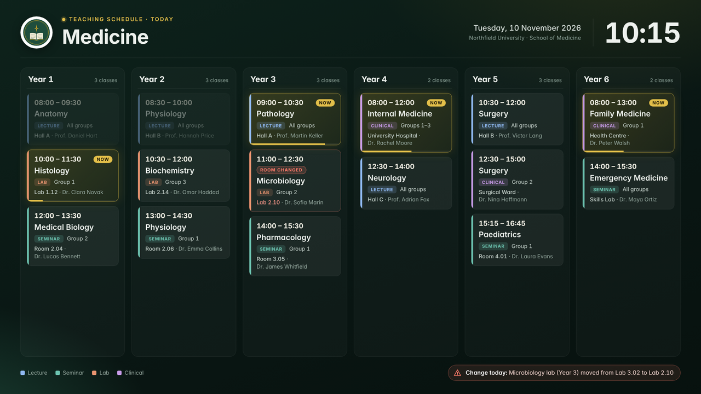
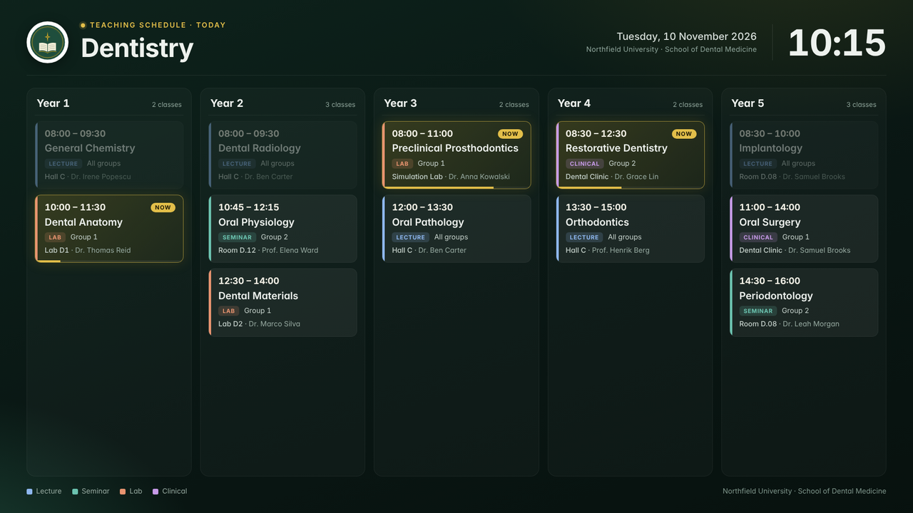
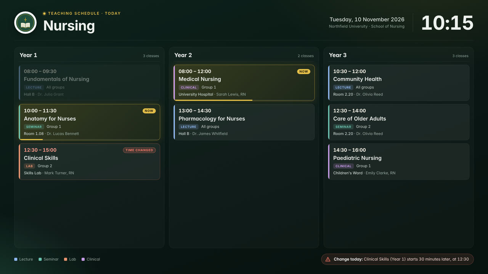
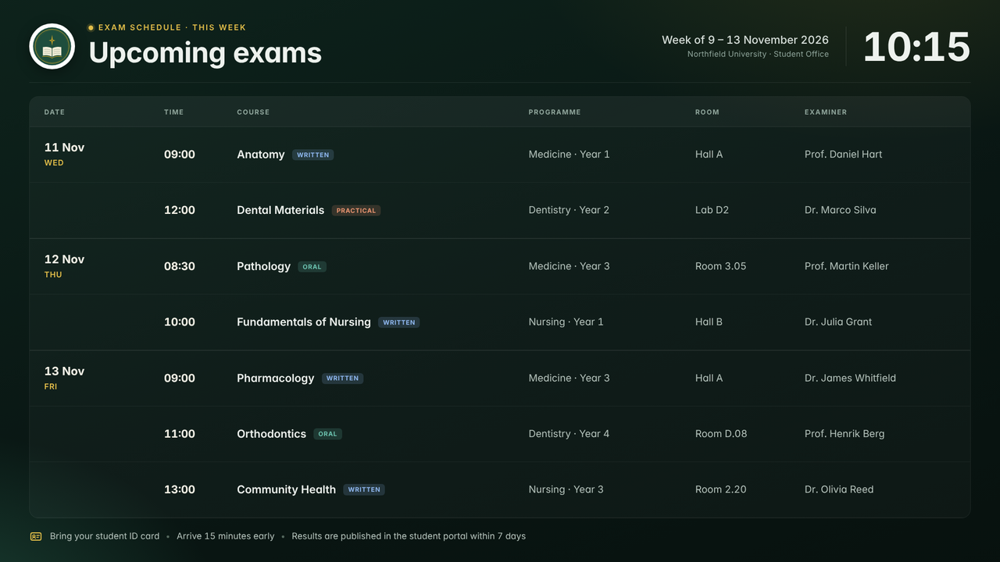
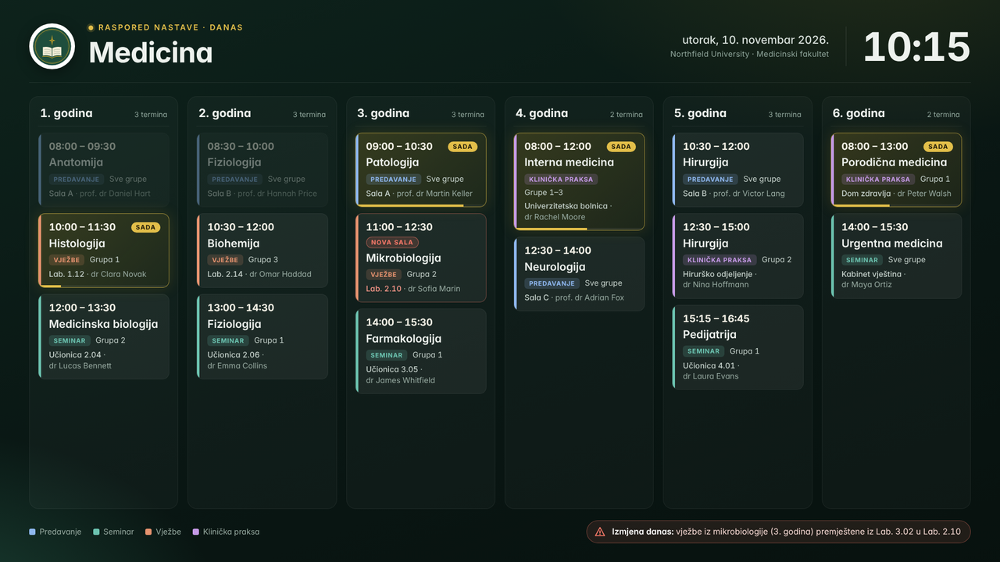

# Example Custom Slides

Example slides for the LobbyCast custom HTML/CSS slide type. All names and data are fictional.

## open-day

An announcement slide that shows every feature of the custom slide format:

- `var(--brand)` and `var(--accent)` colours from Settings
- the `{{logo}}` and `{{ustanova}}` placeholders
- staggered entrance animations under `.show`

Paste [open-day.html](open-day/open-day.html) into the **HTML** field and [open-day.css](open-day/open-day.css) into the **CSS** field.

## demo-kit

Six slides for the fictional "Northfield University". Each file is one self-contained block: a `<style>` element followed by the slide markup. Put the content of the `<style>` element into the **CSS** field and the rest into the **HTML** field.

These slides do not depend on Settings: colours and the logo are built in, and they scale to any 16:9 width through CSS container query units.

| File | Content |
|---|---|
| `01-medicine-schedule-en.html` | Teaching schedule, 6 years, with "now", past and room-change states |
| `02-dentistry-schedule-en.html` | Teaching schedule, 5 years |
| `03-nursing-schedule-en.html` | Teaching schedule, 3 years, with a time change |
| `04-exams-this-week-en.html` | Exam table grouped by day |
| `05-guest-lecture-en.html` | Event poster |
| `06-medicina-raspored-sr.html` | The medicine schedule in Serbian |

| | |
|---|---|
|  |  |
|  |  |
|  |  |
